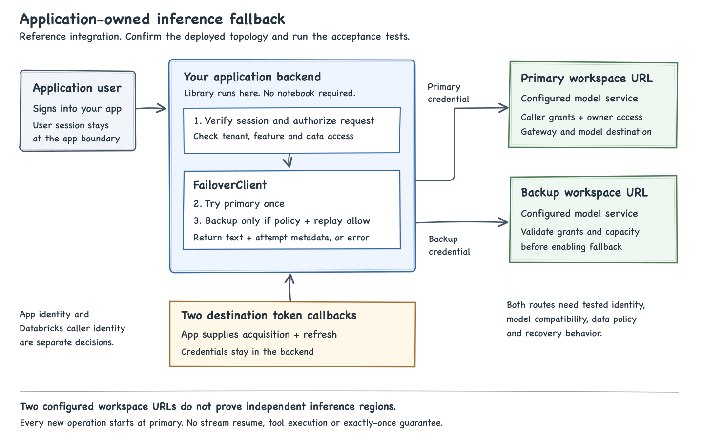

# Databricks inference failover

A small Python library for applications that need to call a backup Unity Gateway workspace route when a primary request fails.

**Status: reference implementation. Live deployment acceptance is pending.** The library controls application requests. It does not provision a model, reserve capacity, configure Gateway fallback or establish that two routes use independent regions. Read the [validation record](docs/validation.md) before using it in production.

## Start here

Use Python 3.11 or later. Clone the repository using an account with access, then install the package locally.

```bash
git clone https://github.com/debu-sinha/databricks-inference-failover.git
cd databricks-inference-failover
python3 -m venv .venv
source .venv/bin/activate
python -m pip install -e '.[dev,auth]'
python -m inference_failover
python -m pytest -q
```

The demo and local tests use synthetic responses. They need no Databricks credentials and make no billable model calls. They demonstrate client behavior, not a regional outage.

## Add it to an application

Install the package in your application's Python backend. Your web application, API handler or background worker imports it and supplies two destinations. The library is not a separate service. It does not need a notebook or Spark cluster.

```python
from inference_failover import Destination, FailoverClient, Policy

# These callbacks must obtain a current credential for the correct workspace.
# Implement them with your approved authentication system. Do not hardcode tokens.
def primary_token() -> str:
    return primary_auth.get_access_token()

def backup_token() -> str:
    return backup_auth.get_access_token()

primary = Destination("primary", primary_workspace_url, primary_service, primary_token)
backup = Destination("backup", backup_workspace_url, backup_service, backup_token)

policy = Policy(
    fallback_statuses=frozenset({502, 503, 504}),
    total_timeout_seconds=30,
    attempt_timeout_seconds=10,
)

with FailoverClient(primary, backup, policy=policy) as client:
    result = client.generate(
        "Summarize this synthetic example.",
        replay_safe=True,
        max_output_tokens=128,
    )
    # Use result.text in the application. Keep sensitive text out of logs.
```

This is an integration sketch. `primary_auth`, `backup_auth` and the destination settings belong to your application. The [runnable example](examples/application.py) reads environment variables and starts in preview mode. It does not renew tokens. See [identity and access](docs/identity-and-access.md) for the production authentication boundary.

Each destination needs its exact HTTPS Azure Databricks workspace URL and three-part Unity Gateway model-service name. The two service names can differ, but you must verify that both provide the required model and version. Do not substitute a legacy serving-endpoint name.

## What happens on failure

1. The library sends one nonstreaming text request to primary.
2. If it receives a status your policy allows, it checks whether the application declared replay safe.
3. If both checks pass and time remains, it sends one request to backup with backup's own credential.
4. If neither request completes, it raises `FailoverError` with attempt metadata.
5. The next operation starts at primary again. This is not a circuit breaker or a verified recovery signal.

No HTTP status permits fallback by default. The example opts into 502, 503 and 504. A 429 can represent an intentional admission or spend control. Only enable 429 fallback after the responsible owner confirms the backup route may accept that request. The library does not automatically bypass authentication, permissions or invalid-request failures.

Timeouts and lost connections leave completion uncertain. Ambiguous replay is disabled by default. Enabling it can produce duplicate work or charges. An operation ID correlates attempts. It is not an idempotency guarantee.

## How it fits



Read the [setup guide](docs/setup.md) for configuration, the [failure policy](docs/failure-policy.md) for exact triggers, the [architecture](docs/architecture.md) for where the library runs, and the [access guide](docs/identity-and-access.md) for authentication and grants. The [production guide](docs/production.md) and [acceptance checklist](docs/acceptance.md) describe the remaining deployment work.

## Scope

This version supports synchronous, text-only, nonstreaming Unified Responses requests. It deliberately excludes tool execution, streaming resume, conversation storage, circuit breakers, provisioning and load generation. These need application-specific behavior and separate tests. A synchronous call should run in a worker rather than block an async web event loop.

Do not stack this policy with another client's automatic retries without calculating the combined attempt count. A Gateway service can also make its own destination attempts. Application attempt counts do not describe those internal attempts.

Unity Gateway's [Unified Responses interface](https://learn.microsoft.com/en-us/azure/databricks/ai-gateway/query-model-services) and [destination fallback](https://learn.microsoft.com/en-us/azure/databricks/ai-gateway/configure-traffic-splitting) are separate product capabilities. Foundation Model APIs can process outside the workspace's region within the applicable geography. [Processing-location documentation](https://learn.microsoft.com/en-us/azure/databricks/machine-learning/foundation-model-apis/compliance).

## Extend it

- Supply refreshable authentication callbacks for your runtime.
- Configure only approved destinations and fallback statuses.
- Read `result.attempts` or `FailoverError.attempts` for safe operational metadata.
- Add integration tests for your exact model, network, identity and API before enabling a new behavior.
- Keep application authorization ahead of the library call. Never let end users choose arbitrary destinations or service names.

See [CONTRIBUTING.md](CONTRIBUTING.md) for the review and test commands. The initial design and tradeoffs are in [the implementation plan](docs/implementation-plan.md) and [ADR 001](docs/adr-001.md).
