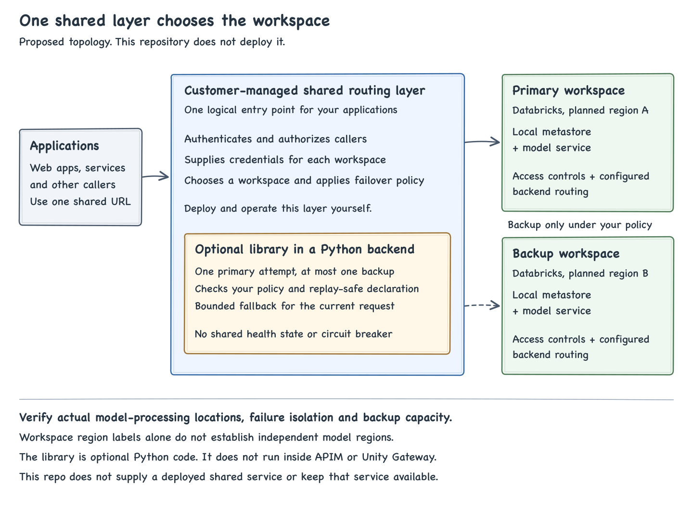

# One shared API, two configured routes

The target is one application-facing API with centrally managed routing to the same approved model and version. The shared routing layer selects a Databricks workspace entrypoint. Applications do not need to select a region or implement their own failover policy.

This is a proposed architecture. The repository supplies a Python client and examples. It does not deploy the shared API, configure APIM or establish regional recovery. [ADR 002](adr-002.md) explains the scope.

## Start with the existing gateway

Evaluate an existing gateway before building another service. Azure API Management supports backend pools, priorities and circuit breakers. Those are useful building blocks, not a tested Databricks integration in this repository. The chosen deployment still needs route-specific authentication, API and model mapping, a replay policy and recovery tests. Python code from this package does not run inside APIM policies. [APIM backends](https://learn.microsoft.com/en-us/azure/api-management/backends).

If a custom Python backend is needed, it can import `FailoverClient`. That backend must supply an HTTP API, caller authentication, request admission, bounded concurrency, health checks and hosting. A Databricks App is an optional host. There is no deployed App, tested Apps authentication path or hosting availability claim here.

## Prepare each regional route

For the PT design, configure a workspace and metastore in each approved region, with a region-local model service and its PT destination. Route switching across workspace entrypoints stays in the customer-managed layer. Do not make one model service depend on PT destinations across the two metastores. Each route needs the same approved model/version, adequate capacity and verified grants. [Regional metastores](https://learn.microsoft.com/en-us/azure/databricks/data-governance/unity-catalog/create-metastore), [PT deployment](https://learn.microsoft.com/en-us/azure/databricks/machine-learning/foundation-model-apis/deploy-prov-throughput-foundation-model-apis).

For hosted pay-per-token models, two workspace URLs do not prove independent regional inference. Processing can occur outside the workspace region under the applicable Geo rules. Model availability, capacity independence and processing locations need separate confirmation. Do not apply the PT deployment picture to a hosted GPT service. [Data processing and residency](https://learn.microsoft.com/en-us/azure/databricks/machine-learning/foundation-model-apis/compliance#data-processing-and-residency).

The service names can differ. Operators must verify that both map to the required model and approved version, including any provider alias change policy. The library does not discover or enforce this mapping.

## Request flow

1. The application authenticates its user and checks the data and actions allowed for that user. The shared API authenticates the calling application and enforces its own access and admission policy.
2. The shared routing layer selects the configured primary workspace and service. It obtains an authorized credential for that route.
3. It sends the model request. A backup attempt depends on the configured failure criteria and whether replay is safe. A timeout or lost connection can leave the original completion unknown.
4. It returns a completed response, or the agreed API error when neither route completes. It must not silently substitute another model or return an old answer as a successful new completion.
5. Its operating policy determines how subsequent requests are routed and when primary traffic resumes. That policy must be tested separately from one successful backup request.

Steps 1 and 5, plus the shared HTTP interface, are not implemented by this library.

## If a Python backend uses the client

The backend calls `FailoverClient.generate` with two configured destinations. The library obtains the primary token and sends one synchronous, text-only, nonstreaming request to `/ai-gateway/mlflow/v1/responses`. This is Unity Gateway's Unified Responses interface, not a legacy Model Serving endpoint path. [Query model services](https://learn.microsoft.com/en-us/azure/databricks/ai-gateway/query-model-services).

The client attempts backup only when `replay_safe=True`, the failure matches the explicit policy and time remains. Default policy permits no fallback. Transport uncertainty also requires `allow_ambiguous_replay=True`. It returns completed text and attempt metadata or raises `FailoverError`. The HTTP layer must map that error to its API contract.

Each new operation starts at primary. There is no persistent circuit breaker, health probe or scheduled failback. Time budgets are cooperative. Synchronous token acquisition, DNS and slow socket reads can exceed a nominal deadline. A cancelled local task does not prove an upstream request stopped. See [production integration](production.md).

## Three separate failure boundaries

| Failure | Where it is handled in the proposed design |
| --- | --- |
| One destination behind a responding Unity Gateway model service fails | Native destination fallback, if configured and supported |
| A configured workspace entrypoint or its route fails | The customer-managed shared routing layer selects the other route under its policy |
| The shared gateway, its host, identity or network fails | The deployment's availability and recovery design. The client cannot repair its own unavailable host |

Native Unity Gateway fallback and shared-layer retries can both make attempts. Review them together because one shared-layer attempt can contain several Gateway destination attempts. The package does not modify Gateway routing. [Gateway routing and fallbacks](https://learn.microsoft.com/en-us/azure/databricks/ai-gateway/configure-traffic-splitting).

A shared endpoint must itself survive the agreed failure. For APIM, regional gateway deployment and backend routing are separate configurations. Supported tiers, network mode and recovery behavior must be checked against the chosen deployment. [APIM multi-region deployment](https://learn.microsoft.com/en-us/azure/api-management/api-management-howto-deploy-multi-region).

## Who owns each part

| Part | Responsibility |
| --- | --- |
| Databricks platform | Serve configured models, enforce service permissions and provide supported destination routing |
| This library | Bounded primary/backup client attempts, explicit replay policy, response parsing and attempt metadata |
| Shared routing layer | Single API, caller authentication, approved model mapping, route credentials, response contract and central routing policy |
| Operators | Workspace and model setup, grants, capacity, secret lifecycle, gateway availability, monitoring and recovery acceptance |

Before production, verify both routes independently with the intended identity and model. Test actual authorized faults, both routes failing, token renewal, backup load, gateway availability and restoration. Neither a synthetic client error nor a later primary success proves regional recovery. See the [acceptance plan](acceptance.md).

This client does not execute tools, resume streams, migrate conversations, replicate data or reserve capacity. The [validation record](validation.md) retains the exact executed scope and open checks.
