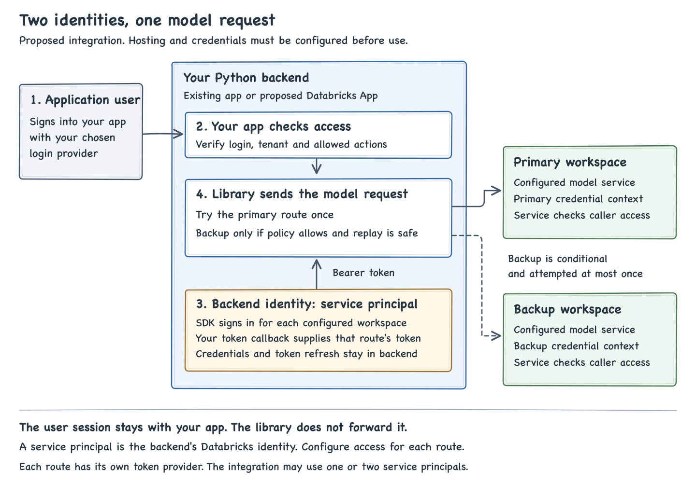
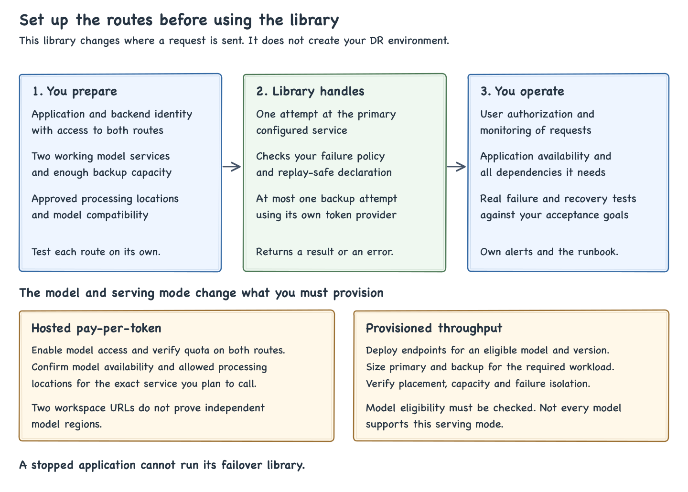

# Start here: what you need to build

The proposal is to put a small Python library in the backend of your application. Your application asks a model for an answer. The library tries the configured primary route and, only under your approved policy, can try a backup route. Your application then uses the answer or handles the error.

You supply two working model routes and the application that calls them. The library supplies the request-level fallback decision. A complete regional disaster recovery design also needs independent serving capacity and an application, network and identity system that survive the failure being tested.

**Current status: reference implementation.** The [test record](validation.md) includes real calls and an unresolved concurrent-request result. Production identity, actual upstream failure and recovery, the intended model and regional independence still need validation.

## The terms used here

| Term | Meaning in this guide |
| --- | --- |
| Application | Your product's web service, API backend or worker |
| Databricks App | An optional Databricks service for hosting an application |
| Workspace URL | The Databricks address to which this library sends a request |
| Model service | A named Unity Gateway resource that routes a request to a model. Its name has the form `catalog.schema.service` |
| Service principal | An application identity with its own Databricks permissions |
| Access token | A short-lived credential presented with an API request |
| Pay-per-token, or PPT | Hosted model access billed by token usage |
| Provisioned throughput, or PT | Serving capacity configured for an eligible model |

## Where does the code run?

Install it in the existing application's Python backend. It does not run inside the model or Gateway. There is no separate failover server, notebook or Spark cluster to start.

A Databricks App can host Python application code. If you choose it, you still need an application entry point, dependency configuration, deployment, permissions and operating setup. This repository provides the library and command-line examples, not those App deployment files. [Databricks Apps](https://learn.microsoft.com/en-us/azure/databricks/dev-tools/databricks-apps/), [App structure](https://learn.microsoft.com/en-us/azure/databricks/dev-tools/databricks-apps/key-concepts).

**If the application stops, its failover library stops too.** Put application availability, its entry URL, login, secrets and network dependencies in the recovery plan. Moving a model request cannot restore a stopped application or its data.

## How authentication works

For the service-principal design shown here, there are two identities. A person signs into your application. The backend uses a Databricks identity to call the model service. Databricks checks the backend's permissions. Your application still checks which user and tenant may request the operation and which data may be included.

The [OAuth example](../examples/application_oauth.py) works as follows:

1. Your deployment supplies a workspace URL, service name, service-principal client ID and OAuth secret for each route.
2. The Databricks SDK uses that route's credentials to obtain a short-lived access token. Its credential provider manages token refresh.
3. The library sends the token with the model request. The secret itself is not sent in the inference request.
4. If backup is attempted, the library asks the backup credential provider for its token. A primary workspace token is not reused as a backup workspace token.

The client ID identifies the application identity. The secret proves control of it. The access token is the credential used for the API call. Authentication establishes who is calling. Permissions determine whether that identity may invoke the service. [OAuth M2M](https://learn.microsoft.com/en-us/azure/databricks/dev-tools/auth/oauth-m2m).

The administrator must grant the caller workspace access and `USE CATALOG`, `USE SCHEMA` and `EXECUTE` for the model service. The service owner's access to the underlying destination is a separate check. Repeat the access checks on both routes. [Model-service grants](https://learn.microsoft.com/en-us/azure/databricks/ai-gateway/model-services#grant-access-to-a-model-service).

### If the host is a Databricks App

Databricks automatically gives an App its own service principal. App authorization and user authorization are separate supported models. In the first, calls use the App's identity. In the second, calls use the signed-in user's delegated identity. [Apps identity model](https://learn.microsoft.com/en-us/azure/databricks/dev-tools/databricks-apps/key-concepts#app-authorization).

This repository's generic OAuth example reads explicit `PRIMARY_` and `BACKUP_` credentials. It does not automatically wire up the App's assigned service principal or grant it access to another workspace. That integration needs configuration and live tests. Do not assume the App's forwarded user token works in a second workspace. See the workspace limit in [Apps authorization](https://learn.microsoft.com/en-us/azure/databricks/dev-tools/databricks-apps/auth#user-authorization).

If every user's Databricks permissions must be enforced individually, design and test user delegation for both destinations. Never replace a denied user request with a more privileged service-principal request. The library does not perform user login or delegation. See [identity and access](identity-and-access.md) for the details.

## Choose the model setup before configuring fallback

"Closed model" describes access to the model's weights. PPT and PT describe how it is served. They are different questions. As of October 13, 2026, Azure's ADI documentation lists GPT-6 Luna, GPT-6 Sol and GPT-6.1 Sol as **pay-per-token only**. Do not plan to deploy these exact models as PT endpoints. Confirm the full model name, since another version can have different support. [ADI Services](https://docs.databricks.com/adi).

| Route choice | What your team prepares | What still needs proof for regional failover |
| --- | --- | --- |
| Databricks-provided model on PPT | Confirm availability and any ADI eligibility, find the approved service in each workspace, grant access, and confirm quota and permitted processing locations. You do not deploy the hosted model's GPUs | Whether the two routes use independent model capacity and which failure each route survives. Two workspace URLs alone do not answer this |
| Eligible model on PT | Create serving endpoints for the required model/version, configure enough capacity for both routes, wait for readiness, and configure model services referencing the intended endpoints | Actual endpoint placement, independence, model compatibility and backup capacity under the expected load |
| Your external model provider | Prepare the provider deployments, capacity, credentials and network access. Configure model provider services and the model services that use them | Whether both Databricks routes ultimately call the same provider deployment, plus the provider's regional and recovery guarantees |

Setup references: [hosted model access](https://learn.microsoft.com/en-us/azure/databricks/machine-learning/foundation-model-apis/), [PT deployment](https://learn.microsoft.com/en-us/azure/databricks/machine-learning/foundation-model-apis/deploy-prov-throughput-foundation-model-apis), [external providers](https://learn.microsoft.com/en-us/azure/databricks/ai-gateway/model-provider-services).

A **region** is a cloud location, such as East US. A **Geo** groups regions for data residency. Hosted inference can run outside the workspace region under the applicable processing-location rules. An East workspace is therefore not evidence of an East model backend. Obtain the exact supported topology before labeling the design regional DR. [Processing locations](https://learn.microsoft.com/en-us/azure/databricks/machine-learning/foundation-model-apis/compliance), [Geographies](https://learn.microsoft.com/en-us/azure/databricks/resources/databricks-geos).

## What you set up, in order

1. **Define the failure to cover.** A model request failure, loss of a workspace entrypoint and loss of the application are different failures. Agree recovery time, allowed locations and whether the backup must use the identical model.
2. **Prepare the model routes.** The workspace and model administrators complete the relevant PPT, PT or external-provider setup above. Confirm both routes expose the Unified Responses interface and support this library's text-only request shape.
3. **Prepare identity and access.** The identity and workspace administrators supply approved service principals, grants and secure secret injection for both routes. For a short lab test, an authorized person's credentials can be used instead. That does not test production M2M authentication.
4. **Integrate the backend.** The application developer imports the library, checks user access before calling it, supplies both credential providers and chooses an explicit failure policy. Keep destinations under deployment control, not user input.
5. **Prove both routes work independently.** Run a primary baseline, then a backup baseline, using the intended model, API and runtime identity. Verify actual token renewal before unattended use.
6. **Test the agreed failures and recovery.** Use an approved isolated fault, then verify backup completion, restoration and later primary use. Test both routes failing, expected load and application dependencies. The local synthetic 503 example does not complete this step.
7. **Accept and operate the deployment.** Assign monitoring and incident ownership, alerts, rollback, backup capacity and application availability. Use the [acceptance plan](acceptance.md) before enabling production traffic.

Complete this worksheet privately before executing the examples. Do not put secrets in it.

| Setting or evidence | Primary | Backup |
| --- | --- | --- |
| Exact Azure workspace URL | Required | Required |
| Existing three-part model-service name | Required | Required |
| Model/version, or alias and version-change policy | Required | Required |
| Serving mode and backing destination | Required | Required |
| Approved processing locations and independence evidence | Required | Required |
| Available quota or provisioned capacity | Required | Required |
| Caller identity and verified grants | Required | Required |
| Secret-manager reference, never the secret | Required | Required |
| Successful independent request with intended identity | Required | Required |

## What the library handles, and what it leaves to you

| Responsibility | This library | Your application or operators |
| --- | --- | --- |
| Try a model route | One primary attempt, at most one backup attempt | Supply working routes and approve replay |
| Decide when to use backup | Apply your explicit policy | Choose allowed errors and business-safe replay |
| Authenticate the API request | Ask the configured token provider, then attach its bearer token | Provision identity, grants and secrets. Configure acquisition and renewal |
| Authenticate the person | Not implemented | Sign-in, tenant, feature and data access |
| Select PPT or PT | No such library setting | Configure the model service and its destinations |
| Provision resources | Not implemented | Workspaces, models, capacity, services and application host |
| Switch all traffic during an outage | Not implemented. Each new operation starts at primary | Add a reviewed circuit breaker or operational routing policy if required |
| Regional recovery | Not established by this client | Verify independence, application availability and actual failure/recovery behavior |

`PRIMARY_SERVICE` and `BACKUP_SERVICE` select existing services. They do not create models or choose their serving mode. Follow [the setup commands](setup.md) to populate the environment variables and run the examples.

Fallback starts disabled. The example CLI can set `--allow-status 503` and `--replay-safe`. Timeout values and replay after uncertain transport failures are configured through `Policy` in the calling Python application. The CLI does not expose those as flags. A regional connection failure might therefore stop rather than try backup under the default settings. Review duplicate-call risk before changing this. Authentication failures never trigger backup. See the [full failure table](failure-policy.md).

Unity Gateway can also perform destination fallback behind the workspace entrypoint. Configure it separately and review the combined attempts and latency. This library does not create or edit that routing. [Gateway routing](https://learn.microsoft.com/en-us/azure/databricks/ai-gateway/configure-traffic-splitting).

The supported library request is synchronous, text-only and nonstreaming. Streaming, tools, conversation persistence, exactly-once execution and load generation need separate application work. Our live calls used GPT OSS 20B and a user identity. They do not validate GPT Luna/Sol, service-principal authentication or a Databricks Apps deployment.
